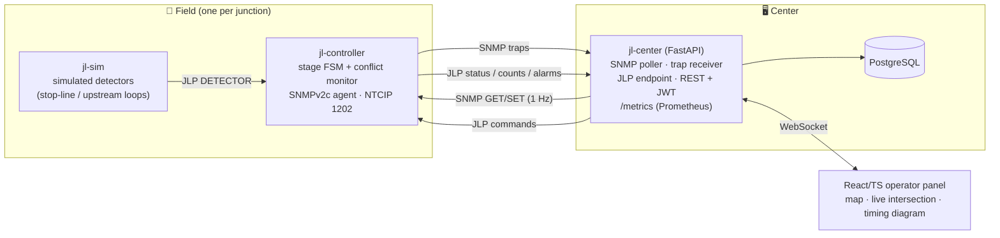
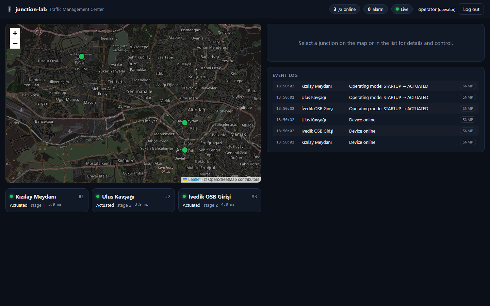
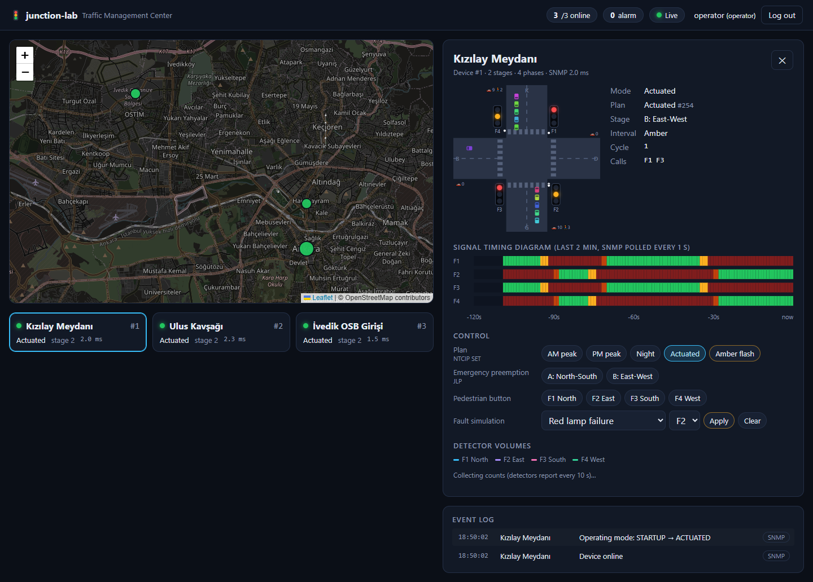
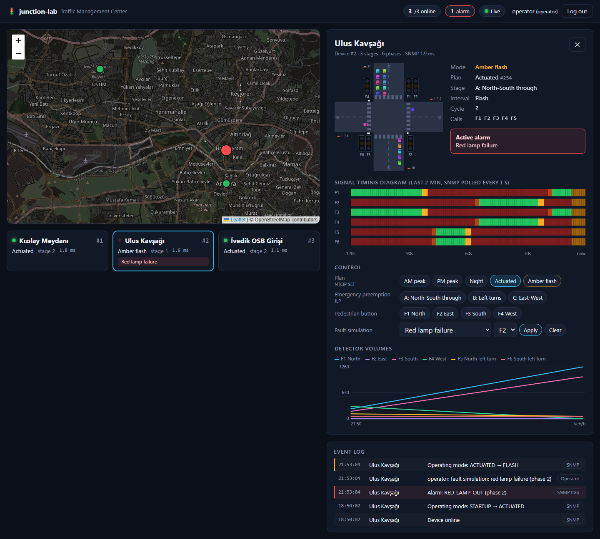
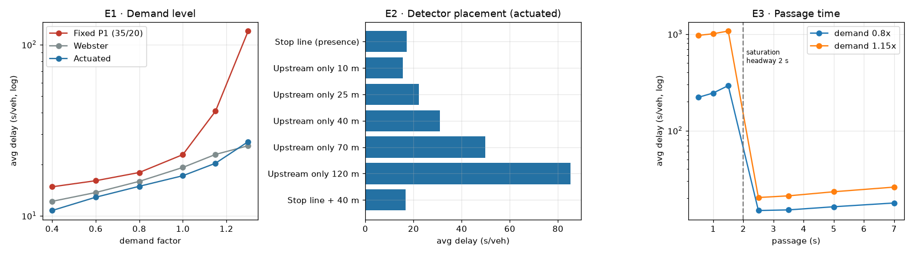

# junction-lab

**An NTCIP-speaking virtual traffic signal controller, a central traffic management system and a simulation lab for signal-control algorithms, built end to end.**

> **Summary:** A virtual junction controller (stage-based signal state machine, an SNMPv2c agent written from scratch
> that serves NTCIP 1202 objects, a CRC-protected binary field protocol), a center that monitors and manages these
> devices over SNMP (FastAPI, PostgreSQL, WebSocket, JWT), a React/TypeScript operator panel, and an experiment suite
> that evaluates signal-control algorithms on our own traffic simulation. Across 990 simulation runs, actuated control
> cuts **average delay by 25 % vs the operator's plan and 11–17 % vs a Webster-optimised plan**, with zero conflicting
> greens. Ships with systemd services, Docker Compose, GitLab CI and a Wireshark dissector.
> Full write-up: [**reports/TECHNICAL_REPORT.md**](reports/TECHNICAL_REPORT.md).



## Screenshots

**Operator panel** — map of the junctions, live status cards and the event log (SNMP polls, traps, operator actions):



**Junction detail** — live intersection with vehicles and signal heads, signal timing diagram, plan / preemption /
pedestrian / fault controls and detector volumes:



**Fault injection** — a red-lamp failure trips the monitor, the controller drops to amber flash, an SNMP trap
raises the alarm at the center:



## Why this project

Traffic controllers are networked embedded devices: a state machine that must never show conflicting greens,
exposed to a central system over SNMP (NTCIP) and over vendor-specific links, monitored and debugged in the
field through logs, metrics and packet captures. This repo builds every layer of that chain small enough to read
in an evening, but with the details that matter in production (fail-safe flash, watchdogs, retries, auth, audit).

## What's inside

| Layer | Where | Highlights |
|---|---|---|
| **Signal controller** | `src/junctionlab/controller/` | Stage-based FSM (green → amber → all-red → red+amber), fixed-time plans, **actuated** control (min green, gap-out, max-out, rest-in-green, skip stages without demand), pedestrian walk/clearance, emergency vehicle preemption, **conflict monitor** and red-lamp monitoring → fail-safe flash, startup all-red. Pure & deterministic: time only advances through `step(dt)`. |
| **SNMP from scratch** | `src/junctionlab/snmp/` | ASN.1 BER codec, SNMPv1/v2c messages, asyncio **agent** (GET / GETNEXT / GETBULK / SET with two-phase validate/commit, v2c traps, community checks) and **manager** (retries, request-id matching, bulk walk). No pysnmp — every byte is understood and tested against known vectors. |
| **NTCIP 1202 subset** | `src/junctionlab/ntcip/mib.py` | `phaseTable` (min/max green, passage… writable), `phaseStatusGroup` (reds/yellows/greens/walks/calls bitmasks), `phaseControlGroup` (place calls), `coordPatternStatus`, `systemPatternControl` (1‑253 plans, 254 free, 255 flash), MIB‑II system group, plus a private branch for things NTCIP doesn't cover. |
| **JLP binary protocol** | `src/junctionlab/proto/frame.py` | Compact framed protocol (magic, version, type, seq, device id, length, payload, **CRC16‑CCITT**) for status heartbeats, detector events, alarms, commands/ACK. Transport-agnostic: UDP here, same frames work on RS‑485. |
| **Central system** | `src/junctionlab/center/` | FastAPI + SQLAlchemy 2 (async; SQLite dev / **PostgreSQL** prod), SNMP poller per junction with online/offline detection, trap receiver, JLP endpoint, volume storage, event log with audit trail, **JWT** auth with operator/viewer roles (PBKDF2 password hashes), **WebSocket** live feed with back-pressure, Prometheus `/metrics`. |
| **Operator panel** | `web/` | React 18 + TypeScript + Vite: Leaflet map, live intersection drawing, **signal timing diagram**, plan / preemption / pedestrian / fault controls, detector volume chart, live event log. |
| **Traffic simulation** | `src/junctionlab/sim/` | Poisson arrivals, saturation-flow discharge, configurable detector placement (stop line / upstream / both / none) and miss rate; `jl-bench` quick comparison and `jl-experiments` parameter-sweep suite with a Webster baseline and an independent safety observer. |
| **Ops** | `deploy/`, `tools/` | systemd units (`Type=notify`, **watchdog**, hardening, `CAP_NET_BIND_SERVICE` for udp/161), install script, Dockerfile + Compose (Postgres + center + 3 devices), GitLab CI, **Wireshark Lua dissector** for JLP, `jl-snmp` CLI (get / walk / set / watch). |

## Results

`jl-bench` runs the same random traffic (60 min, sinusoidal peak, 3 seeds) through each plan of a 4-arm junction:

| Plan | Avg delay / vehicle | Max queue | Served |
|---|---:|---:|---:|
| Fixed – morning peak (35/20 s) | 33.9 s | 30 | 1791 |
| Fixed – evening peak (25/30 s) | 313.2 s | 171 | 1575 |
| Fixed – night (15/12 s) | 444.4 s | 217 | 1484 |
| **Actuated (free, 254)** | **22.8 s** | **25** | **1794** |

Actuated control cuts average delay by **32.6 %** against the *best* fixed plan, and — more importantly — doesn't
collapse when demand doesn't match the plan the operator picked.

### Experiment suite (`jl-experiments`)

11 experiments × 10 seeds × 60 min = 990 runs, each watched by an independent safety observer. Highlights
(details, tables and limitations in [reports/TECHNICAL_REPORT.md](reports/TECHNICAL_REPORT.md)):



| Finding | Numbers |
|---|---|
| Actuated vs fixed P1 / vs Webster (nominal demand) | 17.1 s vs 22.8 s / 19.2 s → **−25 % / −11 %** |
| Passage time below the 2.0 s saturation headway | premature gap-outs, delay 15 s → **245 s** |
| Upstream-only detector, setback 10 m → 120 m | delay 15.5 s → **85.3 s**; stop line + 40 m is the most stable |
| Very high demand (1.3×) | max green binds, Webster (25.6 s) beats actuated (27.1 s) |
| Stop-line detector missing 20 % / 50 % of pulses | delay +43 % / ×8.5 |
| Welded relay / red lamp failure injected | flash in the same 100 ms step; **0 conflicting greens in 990 runs** |

Other numbers from a local run: SNMP poll of 14 objects ≈ 1–3 ms round trip; 46 unit/integration tests in < 2 s.

## Quick start

Requirements: Python ≥ 3.12, [uv](https://docs.astral.sh/uv/), Node 22.

```bash
uv sync                         # python deps
npm --prefix web install
python scripts/dev.py           # 3 simulated controllers + center on :8000
npm --prefix web run dev        # panel on http://localhost:5173  (operator / operator123)
```

Or everything in containers (Postgres, center, three devices on a private network):

```bash
docker compose up --build       # http://localhost:8000
```

### Talk to a device directly

```bash
uv run jl-snmp 127.0.0.1:16101 get sysName greens reds pattern
# sysName = str: Kızılay Meydanı
# greens = int: 5   phases [1, 3]
# reds = int: 10   phases [2, 4]
# pattern = int: 254
uv run jl-snmp 127.0.0.1:16101 walk phaseTable
uv run jl-snmp 127.0.0.1:16101 set pattern 255     # -> amber flash (via amber, never straight from green)
uv run jl-snmp 127.0.0.1:16101 watch               # live phase status
```

### Benchmark & experiments

```bash
uv run jl-bench --preset four_leg --minutes 60 --rates 1:700,2:250,3:650,4:200
uv run jl-experiments            # full parameter sweep -> reports/results.json, see reports/TECHNICAL_REPORT.md
```

## Protocol notes

**SNMP / NTCIP** — devices listen on udp/1161 (161 in Docker/systemd). The poller reads one GET of 14 varbinds per
second per junction. Plan changes are SNMP SETs to `systemPatternControl`; SETs are validated for *all* varbinds
before any is committed (RFC 3416 semantics). Wrong community → silently dropped and counted, like real agents.

**JLP** — `'JL' | ver | type | seq | dev | len | payload | CRC16`, big endian. Load `tools/wireshark/jlp.lua` in
Wireshark to decode it; for SNMP on the non-standard dev ports use *Decode As… → SNMP*.

| Type | Direction | Payload |
|---|---|---|
| `0x01 STATUS` | device → center, 1 Hz | uptime, mode, pattern, stage, interval, green/yellow/red/red+amber/walk bitmasks, alarms, cycle |
| `0x02 DETECTOR` | loop / sensor → device | phase, count, presence |
| `0x03 ALARM` | device → center | alarm flags, phase, raised/cleared |
| `0x04 COUNTS` | device → center, 10 s | cumulative volume per phase (center stores deltas, handles counter reset) |
| `0x10 COMMAND` / `0x11 ACK` | center ↔ device | set pattern, preempt, inject/clear fault, pedestrian call; ACK echoes seq |

## Troubleshooting stories (things that actually broke while building this)

* **Actuated mode was 10× worse than fixed time.** Detectors were modelled at the upstream approach, so vehicles
  already queued at red never actuated the loop when green started — the controller saw a "gap" and cut the
  green after the minimum. Moving the detector to the stop line (presence while queued, a pulse per departing
  vehicle) fixed it: 367 s → 22.8 s average delay.
* **Center saw every device as offline on Windows, though all sockets were bound.** A device had sent a frame
  before the center was up; the ICMP *port unreachable* surfaces as `WSAECONNRESET` on the next `recvfrom()`
  and asyncio's Proactor loop stops reading that UDP socket for good. Services now run on the Selector loop
  (same behaviour as Linux) — see `src/junctionlab/netutil.py`.
* **Trap from an unknown device in Docker.** Junctions are configured by hostname (`ctrl1`) but traps arrive
  from an IP; the center now resolves configured hosts before matching.

## Scope & honesty

* The NTCIP objects are a **learning subset** of NTCIP 1202, structured after the standard's OID tree; they
  have not been conformance tested — verify against the official MIB before relying on exact OIDs.
* The private enterprise number `99999` is a placeholder, not an IANA-registered PEN.
* SNMPv3 (USM auth/priv) is not implemented; v2c communities are plaintext and belong on a VPN only.
* Developed with AI-assisted tooling (Claude Code); architecture, debugging and evaluation are my own work.

## Layout

```
src/junctionlab/
  snmp/        BER codec, PDU model, agent, client, trap receiver
  ntcip/       NTCIP 1202 object mapping
  controller/  junction configs, FSM, device process
  proto/       JLP framing
  center/      FastAPI app, field service, DB models, auth
  sim/         traffic model, benchmark, experiment suite
  tools/       jl-snmp CLI
web/           React/TS panel
deploy/        systemd units, install script
tools/         Wireshark dissector
tests/         pytest (BER vectors, FSM safety properties, SNMP over UDP, JLP)
```

MIT licensed.
