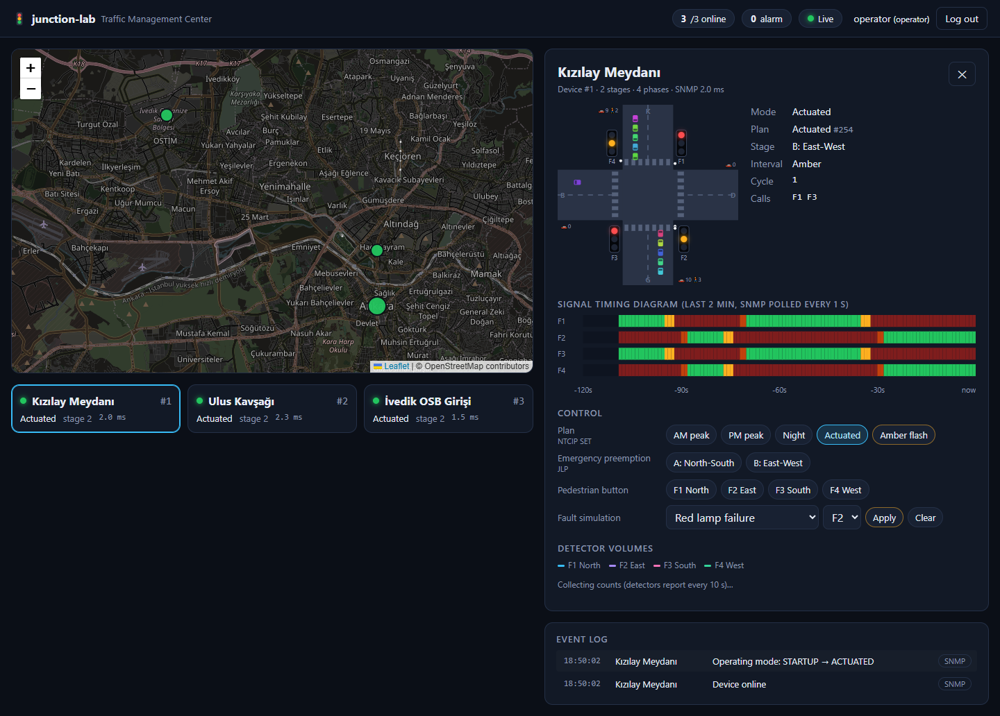
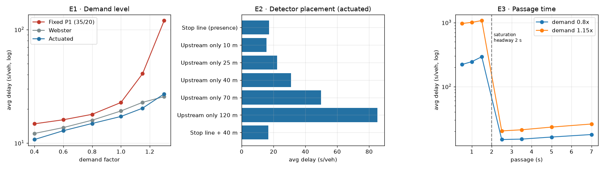

# junction-lab — Technical Project Report

**An NTCIP 1202 virtual traffic signal controller, a central management system, and a simulation-based evaluation of signal control algorithms**

Date: 18 November 2026 · Version: 0.1.0 · Experiment data: [`reports/results.json`](results.json), raw output: [`reports/console.txt`](console.txt)

---

## Abstract

This project builds every layer of a real traffic signal chain from scratch — field controller, communication
protocols, central management and operator panel — and evaluates signal control algorithms on a purpose-built
traffic simulation. The controller is a deterministic, stage-based state machine. It supports fixed-time plans and
actuated control (minimum green, gap-out, max-out, skipping stages without demand, rest in green), pedestrian and
emergency-vehicle priority, and falls back to fail-safe amber flash through conflict and red-lamp monitoring. The
device exposes NTCIP 1202 objects through an SNMPv2c agent written from scratch; the center manages devices over
SNMP and over JLP, a CRC-protected binary protocol.

The algorithms were evaluated in **11 experiments, 99 scenarios, 10 seeds × 60 minutes each = 990 simulation runs**.
Main findings: (i) at nominal demand, actuated control reduces average delay by **24.7 %** against the operator's
fixed plan and by **10.5 %** against a Webster-optimised fixed plan; (ii) **if the passage time is set below the
saturation headway (2.0 s) the system collapses** (delay 15 s → 245 s); (iii) **an upstream-only detector** degrades
performance as its setback grows (10 m: 15.5 s → 120 m: 85.3 s), while stop-line + upstream detection gives the most
stable result; (iv) at very high demand (1.3×) the maximum green limits become binding and the Webster plan beats
actuated control; (v) across all 990 runs an independent safety observer **detected no conflicting greens and no
illegal lamp sequences**; injected welded-relay and red-lamp failures led to amber flash within the same 100 ms step.

---

## 1. Introduction

Traffic signal controllers are networked embedded devices: a state machine that must never show conflicting greens,
connected to a center over SNMP (NTCIP) and vendor-specific links, monitored in the field through logs, metrics and
packet captures. Junction efficiency, in turn, depends mostly on two things: **the parameters of the control
algorithm** (minimum / maximum green, passage time, intergreens) and **where the detectors are and how reliable
they are**.

Trying these parameters on a real junction is expensive and risky. The goals of this project are:

1. Build a realistic controller + center chain end to end, with the details that matter in production (fail-safe
   flash, watchdog, retries, authorisation, audit trail);
2. Run the very same control code (the identical FSM) in an accelerated simulation and **measure** it across
   different junction layouts, demand levels, detector placements and fault scenarios;
3. Report which parameter causes which kind of degradation or safety event.

> Note: the detector layer stays abstract behind the JLP `DETECTOR` frame, so loops, magnetometers, radar or
> any other sensor type can be connected without changing the controller.

---

## 2. System Architecture

```
                 ┌─────────────────────────── field ───────────────────────────┐        ┌──────────── center ─────────────┐
 jl-sim (loops) ──JLP DETECTOR──►  jl-controller  (one per junction)           │        │  jl-center (FastAPI)            │
 (simulated detectors)          │  stage FSM + conflict monitor                 │ SNMP   │  • SNMP poller (1 Hz, NTCIP)    │
                                │  SNMPv2c agent, NTCIP 1202 ◄──────────────────┼─GET/SET┤  • trap receiver                │
                                │  traps ───────────────────────────────────────┼───────►│  • JLP endpoint                 │──► PostgreSQL
                                │  JLP status/counts/alarms ────────────────────┼───────►│  • REST + WebSocket, JWT        │
                                │  JLP commands ◄───────────────────────────────┼────────┤  • /metrics (Prometheus)        │
                                └───────────────────────────────────────────────┘        └───────────────┬─────────────────┘
                                                                                                         │ WS
                                                                                        React/TS operator panel (map,
                                                                                        live intersection, timing diagram)
```

### 2.1 Layers

| Layer | Location | Role |
|---|---|---|
| Signal control FSM | `src/junctionlab/controller/fsm.py` | Stage-based state machine. Pure and deterministic: time only advances through `step(dt)`, so the same code runs in real time on the device and thousands of times faster in tests and simulation. |
| Junction configuration | `controller/config.py` | Phases (signal groups), stages, fixed plans, intergreens. The conflict matrix is **derived automatically** from the stages: two phases that are never green together in any stage → conflicting pair. |
| SNMP | `src/junctionlab/snmp/` | ASN.1 BER codec, SNMPv1/v2c PDUs, asyncio agent (GET/GETNEXT/GETBULK/SET with two-phase validate/commit), manager (retries, bulk walk). No external library. |
| NTCIP 1202 subset | `ntcip/mib.py` | `phaseTable`, `phaseStatusGroup` (red/yellow/green/pedestrian bitmasks), `phaseControlGroup`, `systemPatternControl` (1–253 plans, 254 free/actuated, 255 flash). |
| JLP protocol | `proto/frame.py` | `'JL' | ver | type | seq | dev | len | payload | CRC16-CCITT`. Status, detector, alarm, counts, command/ACK. |
| Center | `center/` | FastAPI + SQLAlchemy 2 (SQLite / PostgreSQL), per-device SNMP poller, trap receiver, event log, JWT roles, WebSocket live feed, Prometheus metrics. |
| Operator panel | `web/` | React 18 + TypeScript: map, live intersection drawing, signal timing diagram, plan / priority / fault controls. |
| Traffic simulation | `sim/traffic.py` | Poisson arrivals, point-queue model, saturation-flow discharge, **configurable detector placement and miss rate**, pedestrian push buttons. |
| Experiment suite | `sim/experiments.py` | Parameter sweeps, Webster reference plan, independent safety observer, parallel execution, JSON output (`jl-experiments`). |



### 2.2 Signal control algorithm

Interval sequence between two stages (phases that stay green across the transition keep their green):

```
GREEN(A) → AMBER(A−B) → ALL RED → RED+AMBER(B−A) → GREEN(B)
```

**Actuated mode (pattern 254)** decides at every step whether the green stage should end:

1. Green time < minimum green (if pedestrians are being served: `max(min, walk + ped_clear)`) → keep green.
2. No demand (call) on any other stage → **rest in green**.
3. Time since the last detector actuation on the stage's phases ≥ passage time → **gap-out**, go to the next stage with demand.
4. Green time ≥ maximum green → **max-out**.
5. Stages without demand are skipped; a stage flagged `recall` (main road) is served every cycle.

**Safety:** at every step the outputs are checked against the conflict matrix; two conflicting greens or a red lamp
failure → immediate amber flash. Even on a plan change, the controller goes to flash through amber, never straight
from green.

### 2.3 Simulation model

- **Arrivals:** Poisson process per approach (veh/h), optional 10-minute sinusoidal peak wave (0.5×–1.5×).
- **Discharge:** during green, after a 2 s start-up loss, at a saturation flow of 1800 veh/h (2.0 s headway).
- **Detector placements:**
  - `stopline` — presence loop at the stop line: a call while a queue waits, a pulse for every departing vehicle.
  - `upstream` — a pulse loop *d* metres before the stop line: a pulse when the vehicle passes it, the vehicle joins the queue `d / 13.9 m/s` later; if the queue spills back over the loop (queue × 7 m ≥ d) the loop is held occupied.
  - `both` — both of the above; `none` — no detection.
- **Miss rate:** a given share of detector pulses is dropped at random (dirty / faulty loop).
- **Metrics:** average delay per vehicle (vehicle-seconds spent queued / vehicles served), maximum queue,
  throughput ratio (served / arrived), average cycle, gap-out / max-out counts.
- **Independent safety observer:** without trusting the FSM's own monitor, it reads the lamp outputs every 100 ms
  and counts conflicting-green time and illegal sequences (green→red without amber, red→green without red+amber).

### 2.4 Reference method: Webster

As a well-tuned fixed-time baseline we used Webster's (1958) optimum cycle:
`C₀ = (1.5 L + 5) / (1 − Y)`, where `L` = lost time per stage (amber 3 + all-red 2 + red-amber 2 + start-up loss 2 = 9 s)
and `Y` = the sum of the critical flow ratios of the stages; greens are split in proportion to `yᵢ / Y`. Actuated
control is therefore compared not only against a poorly chosen fixed plan, but also against an optimised fixed plan
that **knows the demand**.

---

## 3. Experimental Setup

| Item | Value |
|---|---|
| Duration | 60 min of simulated time per run, Δt = 0.1 s |
| Repetitions | 10 seeds (0–9), results averaged; all plans see the same random traffic |
| Total | 11 experiments, 99 scenarios, 990 runs, ≈ 6.6 min wall time with parallel execution on a development laptop |
| Default junction | 4-arm, 2 stages (N-S recall, E-W); N 700, E 250, S 650, W 200 veh/h |
| Default parameters | min green 10/7 s, max green 50/35 s, passage 2.5 s, amber 3 s, all-red 2 s |

To reproduce:

```bash
uv run jl-experiments --seeds 10 --minutes 60          # → reports/results.json
uv run jl-experiments --only E2,E3 --seeds 3 --minutes 30
```

---

## 4. Results



### E1 — Demand level: fixed vs Webster vs actuated

Average delay (s/veh), maximum queue in parentheses:

| Demand | Fixed P1 (35/20) | Webster | Actuated | Actuated vs P1 | Actuated vs Webster |
|---:|---:|---:|---:|---:|---:|
| 0.4× | 14.8 (10) | 12.1 (8) | **10.7** (7) | −27 % | −12 % |
| 0.6× | 16.0 (14) | 13.7 (13) | **12.8** (11) | −20 % | −6 % |
| 0.8× | 17.9 (18) | 15.9 (16) | **14.9** (14) | −17 % | −6 % |
| 1.0× | 22.8 (29) | 19.2 (19) | **17.1** (23) | −25 % | −11 % |
| 1.15× | 40.8 (73) | 22.8 (23) | **20.3** (19) | −50 % | −11 % |
| 1.3× | 119.9 (134) | **25.6** (26) | 27.1 (38) | −77 % | **+6 %** |

**Discussion.** Actuated control is the best over the whole 0.4×–1.15× range. Fixed P1 saturates above 1.15× (queue
grows to 134, throughput ratio 0.94). **At 1.3× demand Webster beats actuated control**: max-outs rise from 5.7 to
29.2 per hour, i.e. the 50/35 s maximum greens are binding and Webster's 102 s cycle (64/24 s) provides more
capacity. This shows that maximum greens should be raised with demand at peak hours (or made plan-dependent) — see E4.

### E2 — Detector placement

| Detector | Delay (s) | Max queue | Avg cycle (s) | Gap-outs / max-outs (per hour) |
|---|---:|---:|---:|---:|
| Stop line (presence) | 17.1 | 23 | 59.5 | 116 / 5.7 |
| Upstream only, 10 m | **15.5** | 17 | 51.3 | 139 / 2.1 |
| Upstream only, 25 m | 22.2 | 23 | 45.8 | 157 / 1.0 |
| Upstream only, 40 m | 31.1 | 19 | 44.0 | 163 / 1.1 |
| Upstream only, 70 m | 49.9 | 22 | 42.2 | 171 / 0.6 |
| Upstream only, 120 m | 85.3 | 32 | 40.8 | 176 / 1.1 |
| Stop line + 40 m | 16.7 | 19 | 65.1 | 101 / 10.8 |
| No detector | 575.5 | 253 | — | 0 / 0 |

**Discussion.**
- **An upstream-only detector gets worse as the setback grows.** Vehicles already queued at red do not actuate the
  loop again when green starts; the controller sees a "gap" and cuts the green at the minimum (gap-outs go up while
  the cycle gets shorter). At 120 m the delay is **5×** that of the stop-line loop. This was exactly the root cause of
  the "actuated mode is 10× worse than fixed time" bug encountered during development.
- **A 10 m upstream loop is slightly better than the stop line**: being so close to the queue, about two queued
  vehicles already occupy it (presence), but the discharging queue leaves it earlier, so gap-out happens sooner and
  the cycle is shorter.
- **Stop line + 40 m** is the most stable configuration (second-lowest delay, one of the smallest queues).
- **Without detectors**, actuated mode serves only the recall stage; the side road never gets green (queue 253).
  When detectors fail, the controller must fall back to a fixed plan or "max recall".

### E3 — Passage time (unit extension)

| Passage (s) | 0.8× delay | 0.8× queue | 1.15× delay | 1.15× queue | 1.15× cycle |
|---:|---:|---:|---:|---:|---:|
| 0.5 | 220.3 | 125 | 964.7 | 435 | 31.9 |
| 1.0 | 244.5 | 132 | 1005.2 | 443 | 32.2 |
| 1.5 | 291.7 | 153 | 1072.1 | 455 | 33.1 |
| **2.5** | **14.9** | 14 | **20.3** | 19 | 71.4 |
| 3.5 | 15.1 | 14 | 21.1 | 20 | 77.2 |
| 5.0 | 16.3 | 15 | 23.2 | 22 | 84.8 |
| 7.0 | 17.8 | 17 | 26.0 | 27 | 91.6 |

**Discussion — the most critical parameter of the system.** At saturation flow vehicles cross the stop line 2.0 s
apart. If the passage time is below this value (0.5–1.5 s), **every green gaps out at minimum green before the queue
has cleared** (~220 gap-outs per hour, ~0 max-outs, 32 s cycle). Capacity is lost and delay jumps from 15 s to 245 s
(0.8×) / 1005 s (1.15×); throughput ratio drops to 0.64. Above 2.5 s the increase is gentle: a longer passage
needlessly extends the green ("wasted green") and delay grows by 20–28 % at 7 s. **Rule: passage > saturation
headway + safety margin; the optimum in this model is 2.5–3.5 s.**

### E4 — Maximum green (demand 1.15×)

| Max green (s) | Delay (s) | Queue | Throughput | Gap-outs / max-outs | Cycle (s) |
|---:|---:|---:|---:|---:|---:|
| 15 | 581.7 | 363 | 0.76 | 66 / 107 | 41.8 |
| 20 | 206.1 | 208 | 0.90 | 71 / 81 | 47.7 |
| 30 | 36.8 | 58 | 0.99 | 67 / 55 | 59.2 |
| 45 | 20.9 | 21 | 0.99 | 82 / 22 | 69.7 |
| 60 | 19.9 | 20 | 1.00 | 94 / 5.6 | 72.8 |
| 90 | **19.8** | 22 | 0.99 | 97 / 0.4 | 74.2 |

**Discussion.** Max-outs exceeding gap-outs is a clear sign that the maximum green is too short for the demand
(15–20 s). Above 45 s returns diminish; there is no difference between 60 and 90 s because the queue already clears
through gap-out. In practice the max-out/gap-out ratio is a good **tuning alarm metric** to monitor from the center.

### E5 — Detector miss rate

| Miss rate | Stop line delay / queue | Upstream 40 m delay / queue |
|---:|---:|---:|
| 0 % | 17.1 / 23 | 31.1 / 19 |
| 5 % | 18.0 / 24 | 31.2 / 20 |
| 10 % | 19.5 / 27 | 31.2 / 20 |
| 20 % | 24.4 / 30 | 31.5 / 20 |
| 35 % | 48.5 / 59 | 31.8 / 26 |
| 50 % | 146.4 / 165 | 31.8 / 20 |

**Discussion.** The stop-line detector is robust up to 10 %; it degrades by +43 % at 20 %, ×2.8 at 35 % and ×8.5 at
50 %: missed pulses turn the 2 s headways into gaps longer than the passage time and cause premature gap-outs (the
same mechanism as E3). The 40 m upstream loop is almost insensitive to misses — but only because it already performs
poorly: its green extensions come mostly from the queue spilling over the loop (presence), not from pulses.
**Conclusion: a miss rate above 10 % on stop-line loops should raise a maintenance alarm.**

### E6 — Junction layouts

| Junction | Fixed P1 | Fixed P2 | Webster (cycle) | Actuated | Actuated vs Webster |
|---|---:|---:|---:|---:|---:|
| 4-arm, 2 stages | 22.8 | 262.5 | 19.2 (68 s) | **17.1** | −11 % |
| 4-arm + protected left turn, 3 stages | 53.6 | 254.0 | 38.6 (102 s) | **33.2** | −14 % |
| T-junction, 2 stages | 16.7 | 21.5 | 16.1 (62 s) | **14.2** | −12 % |

**Discussion.** The cost of a wrong fixed plan is huge: with N-S-heavy demand, choosing the "evening peak" plan P2
raises delay **11×** on the 4-arm junction. Actuated control improves on Webster by 11–14 % on all three layouts.
On the left-turn junction the extra lost time of the third stage (27 s/cycle) doubles delay for every method; the
left-turn phases (5, 6) wait the longest (90 / 57 s under Webster).

### E7 — Pedestrian demand

Raising pedestrian arrivals from 0 to 400 ped/h per crosswalk changed actuated delay from 17.1 to 17.3 s; fixed P1
stayed at 22.8 s. The pedestrian effect is negligible on this junction because (a) both stages already have
continuous vehicle demand, so the push button never calls an extra stage; (b) the pedestrian time (6 + 5 = 11 s)
extends the side road's 7 s minimum green by only 4 s. The pedestrian effect should become visible on low-demand
side roads (future work).

### E8 — Emergency vehicle preemption

| Preemption frequency | None | 10 min | 5 min | 2 min | 1 min |
|---|---:|---:|---:|---:|---:|
| Delay (s) | 17.1 | 18.3 | 19.3 | 26.3 | 25.9 |
| Max queue | 23 | 23 | 29 | 37 | 33 |

Fewer than 6 preemptions per hour cost little (+7–13 %). One preemption every 2 minutes increases delay by 54 %. The
1-minute case being slightly better than the 2-minute one can be explained by the 15 s hold time and the higher
chance of hitting moments when the target stage (E-W) is already green; the difference is within seed variance.

### E9 — Fault injection (t = 600 s) and safety

| Fault | Delay (s) | Gap-outs / max-outs | Flash entered at | Conflicting green (observer) |
|---|---:|---:|---:|---:|
| None | 17.1 | 116 / 5.7 | — | 0 |
| Stuck detector (phase 2 always occupied) | 25.3 | 39 / **46** | — | 0 |
| Welded relay: phase 2 forced green | flash* | — | avg. 605.9 s | **0 steps** |
| Red lamp failure (phase 3) | flash* | — | 600.1 s | 0 |

\* Because the simulation gives no approach right of way during amber flash, the delay value (~7750 s) is not
meaningful; in reality a flashing junction runs on priority rules. What matters here is the safety behaviour.

**Discussion.**
- **A stuck detector** causes no conflict but causes inefficiency: the E-W stage maxes out every cycle (max-outs
  5.7 → 46 per hour), the cycle grows from 59 to 85 s, delay +48 %. The sudden jump in max-outs can be used to
  diagnose detector faults remotely (`DETECTOR_FAULT` alarm + trend at the center).
- **Welded relay** (phase 2 stays green on its own): while phase 2's own stage is green there is no conflict; at the
  first step the controller tries to switch to the N-S stage (on average 5.9 s later) the conflict monitor trips and
  the controller enters flash **in the same 100 ms step**. The independent observer saw no lamp-level conflicting
  green in any of the 10 seeds.
- **Red lamp failure** caused flash at the first step after injection (600.1 s).
- **Across all experiments (990 runs, ≈ 35.6 million steps):** conflicting greens = 0, illegal lamp sequences = 0.

### E10 — Demand profile

| Profile | Fixed P1 | Webster | Actuated |
|---|---:|---:|---:|
| Flat demand | 22.8 | 19.2 | **17.1** |
| Peak wave (0.5×–1.5×) | 33.4 | 27.1 | **22.4** |

Under varying demand the advantage of actuated control grows (vs Webster −11 % → **−17 %**): fixed plans are tuned
for average demand, saturate at peak moments and waste green at low moments.

### E11 — Intergreens (amber + all-red)

| Amber + all-red | 3+1 | 3+2 (default) | 4+2 | 4+3 |
|---|---:|---:|---:|---:|
| Delay (s) | 15.9 | 17.1 | 18.5 | 20.2 |
| Avg cycle (s) | 55.9 | 59.5 | 63.7 | 68.1 |

Each extra second of intergreen adds ~4 s to the cycle and ~8 % to delay on a 2-stage junction. Intergreens are,
however, set for **junction clearance safety** (approach speed and junction width), not efficiency; this table only
shows the price of an intergreen extended for safety reasons.

---

## 5. Discussion

**Parameter → event summary**

| Parameter / condition | Observed event | Recommended threshold / action |
|---|---|---|
| Passage < 2 s (saturation headway) | Premature gap-out, capacity collapse, delay ×15–50 | Passage ≥ 2.5 s |
| Max green ≤ 20 s (1.15× demand) | Max-outs > gap-outs, throughput 0.76–0.90 | Monitor max-out/gap-out ratio; raise if > 0.5 |
| Upstream-only detector, setback ≥ 25 m | Queued vehicles not detected, green cut early | Add a stop-line presence loop |
| No detector / total detector failure | Side road never served | Fall back to a fixed plan or max recall |
| Detector miss rate ≥ 20 % | Delay +43 % … ×8.5 | Maintenance alarm above 10 % misses |
| Stuck detector | Constant max-out, delay +48 % | Correlate max-out jumps with `DETECTOR_FAULT` |
| Welded relay / red lamp failure | Conflict risk | Monitor enters flash in the same step (verified) |
| Demand > 1.3× | Actuated falls behind Webster | Raise max green at peak or use plan-based max |
| Frequent preemption (≤ 2 min) | Delay +54 % | Post-preemption recovery strategy |

**Limits of validity.**
- The point-queue model uses the physical queue length only approximately, for the upstream loop; there is no car
  following, lane changing, turning movements or network spillback.
- Saturation flow and start-up loss are constant (1800 veh/h, 2 s); in real junctions they vary with the number of
  lanes, gradient and heavy-vehicle share.
- The delay metric is queued time only; acceleration/deceleration losses are not included.
- Results are for a single junction; coordination (green waves) was not evaluated.
- Results are averaged over 10 seeds; small differences (< 5 %, e.g. 1 min vs 2 min in E8) are within variance. The
  per-scenario min/max across seeds are in `results.json` under `delay_min` / `delay_max`.

---

## 6. Conclusion and Future Work

The project delivers the full chain from an NTCIP-speaking controller to the center, plus a reproducible algorithm
experimentation environment on top of it. Actuated control beats both the operator plans (−25 %) and the
Webster-optimised plan (−11 % … −17 %) at nominal and varying demand; however, this gain **depends on correct
detector placement and correct passage / max-green tuning** — with wrong settings the same algorithm performs far
worse than fixed-time control. On the safety side, no conflicting green was observed in 990 runs, and injected
critical faults led to fail-safe flash within the same control step.

Future work:
1. An algorithm that adapts maximum green to demand at peak hours (adaptive max) or uses queue prediction, to close the gap to Webster at 1.3× demand.
2. A detector health module: automatic fault detection from miss rates and max-out jumps.
3. Multi-junction corridor simulation with offsets/coordination (NTCIP `coordPatternStatus`).
4. Cross-validation against a more detailed car-following microsimulation.
5. The effect of pedestrian push buttons on low-demand side roads.

---

## Appendix A — Files and commands

| What | Where |
|---|---|
| Experiment suite | `src/junctionlab/sim/experiments.py` (`uv run jl-experiments`) |
| Simulation (detector models) | `src/junctionlab/sim/traffic.py` |
| Quick comparison | `uv run jl-bench --preset four_leg --minutes 60` |
| Raw results | `reports/results.json`, `reports/console.txt` |
| Unit tests | `uv run pytest` (46 tests) |
